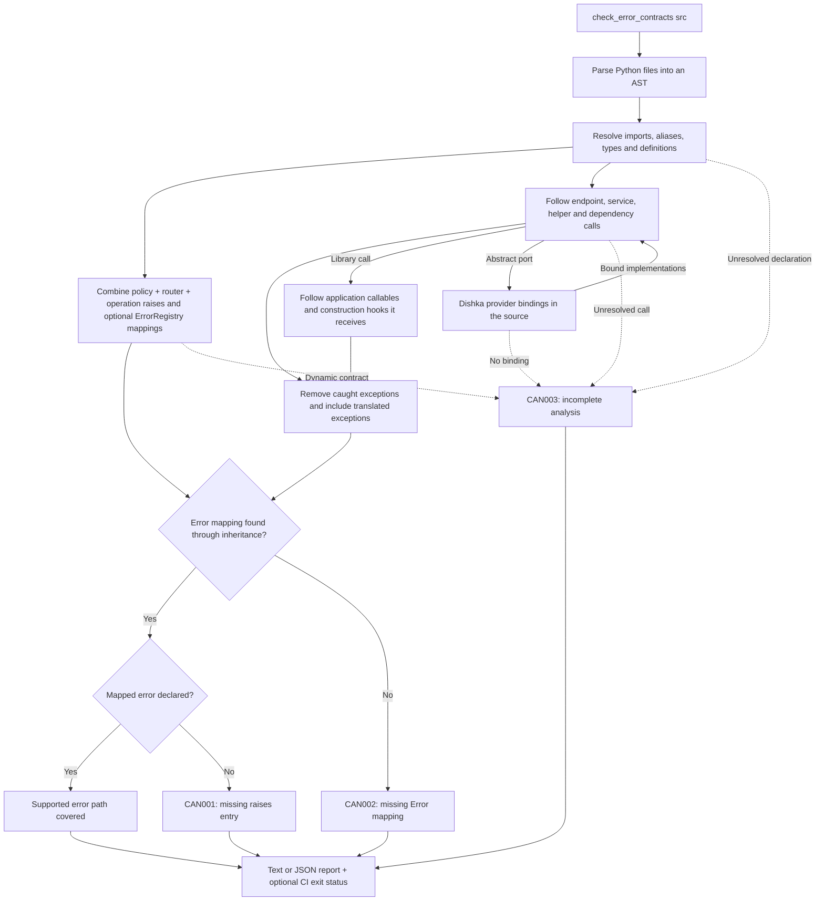

# Optional error-contract checking

Run the source checker to find application exceptions missing from the
`raises=` declarations of `APIRouter` operations, SSE streams and WebRTC
sessions, and of `RpcChannel` methods:

```console
fastapi-canon check errors src
```

Pass Python import roots: for `src/app/features/...`, use `src`, not `src/app`.
The equivalent module command is
`python -m fastapi_canon.check_error_contracts src`.
Multiple roots are accepted when they contain different modules. In this
workspace, run:

```console
uv run --frozen fastapi-canon check errors examples/reference-service/src --strict
```

The checker is included in Canon and needs no extra dependencies or annotations
on application services. It parses source without importing the inspected
application, constructing a Dishka container, or opening application resources.
It is optional development tooling; normal route registration, runtime exception
mapping and OpenAPI validation keep their existing behavior.

## How the check works

The checker compares two sets for each operation: application exceptions escaping
the supported source paths, and errors declared by that operation and its router.
It reads both from source; it does not execute the application.



For example, `complete_task` calls `TaskService.complete`, which can explicitly
raise `TaskNotFound`. A `raises=[task_not_found]` declaration supplies both its
mapping and its operation contract. Removing that declaration produces `CAN002`
with the call path; an explicit registry mapping without the declaration produces
`CAN001`. If the same service calls an abstract repository method, the checker
follows the implementation that a Dishka provider in the scanned roots binds to
that port. Without such a binding the call produces `CAN003`: a known gap and an
incomplete analysis can appear together.

The command is the supported entry point. The `checks` implementation modules,
their types and constants, and the report objects are private implementation details;
the documented JSON fields are the machine-readable interface.

## Findings and CI

The [README walkthrough](../README.md#check-that-errors-are-mapped-and-declared)
provides a minimal example: `get_project` calls `require_project`, which raises
`ProjectMissing`. Remove the operation's `raises=[project_missing]` and run
`fastapi-canon check errors src --strict --require-complete`: it reports `CAN002`
and exits one. Restore the declaration to obtain zero gaps for that supported
HTTP path. An explicit registry mapping without `raises` produces `CAN001`.

A successful check covers the supported source paths of the transports listed
under [Transports](#transports), not arbitrary runtime exceptions.

Given a service method that raises `TaskNotFound`, an endpoint calling that method
must declare its mapped `task_not_found` error, either locally or on its router.
The checker reports the source location and resolved call path when it is missing:

```text
service.py:24: CAN001 [app.router.complete_task] app.service.TaskNotFound: app.errors.task_not_found is missing from raises
  app.router.complete_task -> app.service.TaskService.complete
```

| Code | Meaning |
| --- | --- |
| `CAN001` | An explicit application exception has a registry mapping that is missing from the operation's combined `raises`. |
| `CAN002` | An explicit application exception has no mapping in `raises` or the router's registry. |
| `CAN003` | A declaration or execution path could not be fully analyzed. |

Default mode prints findings and exits zero. Use `--strict` to exit one for
contract gaps. Use `fastapi-canon explain CAN003` for a code's meaning, example,
repair and guide, including [JSON explanations](diagnostics.md#json-explanation-contract).
Incomplete analysis remains visible and does not fail strict mode by itself.
Add `--require-complete` to fail for incomplete operations or a scan containing no
supported operations. Use both flags when both conditions should fail CI:

```console
fastapi-canon check errors src --strict --require-complete
fastapi-canon check errors src --strict --format json
```

Invalid roots, duplicate module names, unreadable files and syntax errors exit
two. JSON output includes each operation's `transport` (`http`, `sse`, `webrtc`
or `rpc`), its diagnostics, a `complete` flag,
`contract_gaps` and `incomplete_operations`. An operation can be fully analyzed
and still contain a contract gap. An empty result does not establish coverage.

`--strict` and `--require-complete` are independent: the former checks
CAN001/CAN002 contract gaps; the latter checks CAN003 or an empty supported scan.
Run `fastapi-canon check errors --help` for these defaults and exit codes. The
module entry point `python -m fastapi_canon.check_error_contracts` remains
supported. Application code is never imported by source analysis, and a complete
result covers its supported explicit paths rather than all runtime exceptions.

When an error catalog or `raises` sequence cannot be resolved, the checker reports
incomplete analysis instead of guessing which errors are missing.

## Performance in CI

The checker reads each source file once and reuses function summaries and
inheritance results within that invocation. Summaries retain the first error path
per exception, matching the report's existing behavior. Cached summaries also
retain dependencies on modules with uncertain declarations; recursive call paths
remain incomplete. All caches are discarded when the check finishes, so each new
invocation reads the current source.

Local Windows/Python 3.14 measurements with dependencies installed and a warm
filesystem cache:

| Workload | Source processing | Full CLI invocation |
| --- | --- | --- |
| Reference service: 43 files, 4 operations | 18–39 ms | 1.0–1.9 s |
| Synthetic shared helper graph: 102 files, 1,000 operations | 0.26 s | 1.32 s |
| Synthetic shared helper graph: 1,002 files, 10,000 operations | 4.93 s | 6.63 s |

The 1,000-operation case improved from 7.70 s to 1.32 s for the full command,
using five-run medians. Before/after reports have identical fingerprints,
including source locations, error paths and incomplete-analysis diagnostics.
The 10,000-operation case uses a three-run median. These synthetic workloads
exercise shared services and repeated helper calls; they are measurements, not CI
time limits or guarantees for other projects. Python and Canon's existing
FastAPI/Dishka imports account for most of a small project's command time.

Pass all relevant import roots in one invocation to pay interpreter startup once.
Measure on your CI runner before setting a time budget. From this repository, use:

```console
uv run --locked python scripts/benchmark_error_contracts.py --output dist/checker-benchmark.json
```

The benchmark generates its workload under `dist/`, measures source processing
and fresh CLI processes separately, and records Python/platform metadata. Use
`--compare dist/previous-benchmark.json` to verify unchanged report fingerprints;
`--profile dist/checker.prof` records a cProfile capture. CI regression tests
verify that shared helpers are analyzed once and cached results preserve
completeness, rather than asserting machine-dependent wall-clock thresholds.

## Transports

| Declaration | Compared with |
| --- | --- |
| `@router.get(...)` and other HTTP methods | Endpoint and dependency failures against policy, router and operation `raises=`. |
| `@router.sse(...)` | Dependency and stream body failures, including iterated service generators, against router and stream `raises=`. |
| `@router.webrtc(...)` | Session factory and dependency failures against router and session `raises=`. |
| `@channel.method` on an `RpcChannel` | Method failures against the channel and method `raises=`. |

One SSE `raises=` declaration covers both phases: dependency failures become
HTTP problem responses, stream body failures terminal `canon.problem` events.

For RPC, the checker reads `RpcChannel(raises=[...])`, an optional
`error_registry=` and `Error` declarations. `RpcError` subclasses and `RpcErrorBinding` declarations are
reported as unresolved contracts (`CAN003`). Contracts of channels included into
other channels do not propagate, like router contracts.
`.method` decorators on other objects are ignored.

## Supported source patterns

The checker follows direct `APIRouter` declarations with ordinary route
decorators, including `api_route`. It reads literal `ErrorRegistry(errors=[...])`
and named `Error` definitions. A direct, statically resolved `RouterPolicy` supplies
its registry, dependencies and shared errors. Policy, router and operation `raises`
combine; supported
sequences include named lists/tuples, unpacking and concatenation. Router contracts
do not propagate to separately included child routers.

Analysis follows imports, aliases and explicit re-exports within the supplied
roots; typed service methods, including `Inject[Service]` and
`FromDishka[Service]`; direct helper calls; simple constructor-injected `self`
attributes; and annotated return values.
It also follows function dependencies declared with `Depends` or `Security`,
including `Annotated` aliases, nested dependencies and router/operation dependency
lists. Dependencies supplied later while mounting an application are outside this
source-declaration check.

### Dishka ports

Calls to an abstract method or a `Protocol` member follow the implementations
that `Provider` classes in the scanned roots bind to that port. The checker reads
these bindings without constructing a container:

```python
class TaskProvider(Provider):
    # The return annotation names the port; the returned constructor names
    # the implementation. Iterator[T] and AsyncIterator[T] factories provide T.
    @provide(scope=Scope.REQUEST)
    def task_repository(self, session: AsyncSession) -> TaskRepository:
        return SqlTaskRepository(session)

    # provides= names the port; the first argument or source= names the class.
    verifier = provide(LocalTokenVerifier, provides=TokenVerifier, scope=Scope.APP)
```

`@provide(provides=Port)` and `alias(source=Impl, provides=Port)` are read the
same way. When several providers bind the same port, including `override=True`
providers and test providers within the roots, the call contributes the union
of their errors. A port without a binding, or a factory whose returned class is
not statically known, keeps the operation incomplete (`CAN003`). Abstract calls
on `self` without a binding follow the concrete subclasses in the roots, such as
`to_domain` hooks of a generic repository base class.

Explicit `raise` statements propagate through supported function calls and simple
branches. `try`/`except` removes caught exceptions, preserves bare re-raises and
includes translated exceptions from handlers. Exception matching and registry
selection follow statically resolvable Python inheritance order, so a more
specific registered error takes precedence over a base mapping. Conditions are
not proved feasible: a finding describes a possible source path, not a guarantee
that a particular request reaches it.

### Library calls

Mapped errors are application exceptions, so a call into code outside the
scanned roots, such as the standard library, Pydantic or SQLAlchemy, contributes
no escaping errors of its own. The checker treats a call as a library call when
its target resolves to a package that the import path can locate outside the
scanned roots. Locating a package does not import or execute it. Run the checker
in the application's environment so that its dependencies are found.

```python
class TaskRepository:
    def __init__(self, session: AsyncSession) -> None:
        self._session = session

    async def list_recent(self, user_id: UUID) -> list[Task]:
        # select(...) and the typed session are library calls.
        statement = select(TaskModel).where(TaskModel.user_id == user_id).limit(20)
        rows = await self._session.scalars(statement)
        return list(map(self.to_domain, rows))  # to_domain is followed
```

Receivers are recognized through parameter, constructor and field annotations,
module-level library objects such as `bearer = HTTPBearer()`, literals and
chained calls on library results. A FastAPI dependency on such an object, for
example `Depends(bearer)`, is a library dependency.

Library code reaches application code only through what it receives, and the
checker follows that code:

- An application function, method or lambda passed as an argument is analyzed
  as if the library called it.
- Constructing a class with a library base class or a library class decorator
  (Pydantic models, SQLModel tables, `@dataclass`) follows its `__new__`,
  `__init__`, `__post_init__`, `__attrs_post_init__` and `model_post_init`
  methods. Other decorated methods on such classes, such as Pydantic validators,
  keep the operation incomplete (`CAN003`).

Calls stay unresolved (`CAN003`) when their package cannot be located, when the
package contains a scanned root (for example the installed application during a
partial scan), for dynamic builtins such as `getattr`, `super` and `next`, and
when a method on an untyped library result has the name of an application
method.

## Comprehensions and deferred generators

List, set and dict comprehensions follow supported explicit calls in their
iterable expressions, filters and results (both keys and values for dicts).
Multiple clauses and nested eager comprehensions are supported. The first
iterable uses its enclosing environment; target names are local to the
comprehension, including names introduced by later clauses. They do not replace
outer bindings. As with ordinary loops/branches, analysis conservatively follows
possible paths without proving cardinality or filter feasibility.

Async eager comprehensions support awaited application helpers and directly
resolved async-generator iterables. Recognized custom iteration protocols,
unresolved async iterators, unresolved element-method dispatch, mutating
attribute/subscript targets and assignment expressions retain CAN003. Container
annotations do not establish the concrete implementation of each element;
implicit Python iteration, hashing and operator behavior remain outside the
explicit-call model.

Creating a generator expression evaluates its outermost iterable expression but
does not execute result/filter helpers. The checker records deferred CAN003 and
does not invent executed-body gaps. Direct `for`/`async for` iteration or an eager
comprehension consuming that expression follows its body. Stored generator
aliases and arbitrary library consumers are not proven by this bounded model.
An unawaited coroutine result also remains deferred/incomplete.

For example, `[require_item(item_id) for item_id in item_ids]` now follows
`require_item` with the same CAN001/CAN002 mapping/declaration distinction and
call trace as an ordinary call. An enclosing `try/except Missing` catches its
explicit Missing path. Declaring the corresponding Error in `raises` covers it.

The reference service's `list_tasks` path includes comprehensions in the
[repository](../examples/reference-service/src/app/features/tasks/infrastructure/repository.py)
and [presentation mapper](../examples/reference-service/src/app/features/tasks/presentation/mapper.py).
Its two `unsupported expression: ListComp` diagnostics disappear. The full scan
still reports six operations, zero contract gaps and five incomplete operations:
unresolved `super().__init__`, inherited dispatch and nested route factories
remain explicit boundaries. Its strict/require-complete command still exits 1;
this change does not claim a fully validated reference application.

## Analysis boundaries

`complete` describes analysis of the supported explicit source paths, not proof
that no other runtime exception can occur. The checker does not model implicit
interpreter errors, every Python protocol or implicit descriptor invocation,
framework internals, application startup, transactions or background tasks.
Explicit built-in exceptions are outside the application-error comparison.

Unresolved calls, unbound abstract ports, decorated hooks of library-based
classes, custom decorators,
recursive calls, dynamic contracts, nested route factories, deferred coroutine
execution and unsupported control flow produce `CAN003`. `for`, `async for` and
`while` loops are analyzed like branches that may run; iterating a call to a
generator follows the generator's body. Supported comprehensions and deferred
generator expressions are described above. Context managers, `match` and
`except*` are currently outside the supported flow analysis. Reassigned module declarations and detected contract mutations also
prevent a complete result, including assignments with type annotations. Expanded
`ErrorRegistry(**config)` arguments are unresolved contracts: the checker reports
`CAN003` and suppresses guessed gaps for those operations. Dishka providers are
read, not executed: bindings added to `Provider()` instances at runtime, or
declared in providers outside the scanned roots, are not
inferred, and an abstract port without a statically visible binding remains
incomplete.

Library calls are assumed not to raise application exceptions except through
the application callables and construction hooks they receive. Methods that a
library calls later on objects it stored, such as an overridden
`logging.Handler.emit`, are not followed.

Only source route declarations are inspected; the tool does not establish which
routers are actually mounted, follow `dependency_overrides`, or validate composed
registries from other features. Pass all relevant source roots, retain runtime
contract validation and test the application's intended error paths.

When the scanned source contains `Composition(router_policy=...)`, the checker
marks operations incomplete and suppresses guessed contract gaps: determining
which operations inherit that policy requires analyzing application mounting.

Plain FastAPI routers are skipped. Supported Canon HTTP, SSE, RPC and WebRTC
declarations are described above. Analysis follows supported explicit generator
paths; failures after response start still use their transport's terminal
problem/protocol handling. Source completeness does not validate that runtime
error phase or guarantee that every possible exception is declared.
