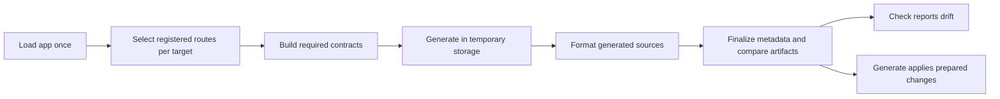

# DX-033: Generate clients from selected application routes

- Status: Typed Python export implemented in this checkout; pipeline API proposal
- Priority: P1
- Kind: Feature and API decision
- Baseline: `d23cd5687bb2b93550e1f83ef5e062e77d03a54e` (`origin/main`, 2026-11-12)
- Depends on: Existing version-2 workflow
- Earlier review: [Issue #154](https://github.com/mathisarends/fastapi-canon/issues/154)

Declare one application and several independent client targets. Each target
selects its registered routes before Canon builds its transport contract. Canon
then generates and formats every selected target in temporary storage before
comparing or updating the finished artifacts.

Typed Python export with feature references is implemented in this checkout and
requires the next minor release, 0.20.0. The proposed version-3 configuration below
is **not implemented**. The current version-2 configuration remains documented in
[client generation](../docs/codegen.md).

## Problem and reproduction

Version 2 already provides one application reference, multiple targets, a
TypeScript default, configuration-relative paths, native ownership manifests,
offline generation and external commands. These should remain familiar.

However, `generate()` calls `export_contracts(app)` for all contract kinds before
rendering any target. Its early return on contract drift blocks client checks.
Native rendering is preflighted, but contracts and client targets are subsequently
written in sequence; external commands can leave partial output.

Two conflicts were reproduced with real FastAPI applications on this baseline:

| Registered RPC endpoints | Full export | OpenAPI-only export |
| --- | --- | --- |
| `control` at `/v1/rpc` and `/v2/rpc` | Ambiguous endpoint, both paths reported | Succeeds |
| Distinct endpoint names with service versions 1 and 2 | Mixed protocol versions | Succeeds |

The baseline `export_contracts(app, kinds=("openapi",))` already avoids the unrelated
RPC failure. The workflow does not use that capability to limit export to the
selected targets. Filtering a completed OpenRPC document would be too late: the
exporter rejects these applications before returning a document.

`inspect_app()` currently describes HTTP operations recorded at composition time.
It does not supply a complete, current inventory of RPC routes or their feature
ownership. Reusing it unchanged would miss the central case in this issue.

The consumer's source-repair scripts are reported in the issue. Their exact
inputs and failures still need focused reproductions before changing templates.

## Proposed configuration

Keep one file and the current transport generator names. Use a new configuration
version because contract locations and check semantics change:

```toml
[codegen]
version = 3
app = "backend.application:create_app"
contracts = "generated/contracts"

[codegen.targets.browser_tunnel]
generator = "websockets"
select.features = ["browser_tunnel"]
client-name = "BrowserTunnelClient"
output = "../frontend/src/api/browser-tunnel"

[codegen.targets.session_media]
generator = "websockets"
select.features = ["usability_test_session"]
client-name = "SessionMediaClient"
output = "../frontend/src/api/session-media"

[codegen.targets.agent]
generator = "sse"
output = "../frontend/src/api/agent"

[codegen.targets.screencast]
generator = "webrtc"
output = "../frontend/src/api/screencast"
```

Support the same tables under `[tool.fastapi-canon.codegen]` in `pyproject.toml`.
Resolve declared relative paths and command working directories from the
configuration directory. Preserve the synchronous application/factory loading
rules, TypeScript default and supported transport-specific options.

Keep target names as build identifiers. Preserve the current `ApiClient` default
where a generator has a class name, and use `client-name` for a public name.
Deriving that name from the target would make a build-configuration rename change
consumer imports. SSE retains its existing operation-based API. Python RPC targets
retain an explicit `package` option and its current default.

### Selection rules

Selection belongs in an optional `select` table so it can grow without mixing
route selection with generator settings. Start with two selectors:

| Selector | Meaning | Appropriate use |
| --- | --- | --- |
| `features` | Exact declared feature names | An existing composition boundary already matches the client |
| `paths` | Exact effective registered path templates | An app without composition, a partial feature, or repeated mounts |

For example, an application using ordinary FastAPI registration can select a
mounted RPC endpoint without declaring a Canon feature:

```toml
[codegen.targets.control_v2]
generator = "websockets"
select.paths = ["/api/v2/projects/{project_id}/rpc"]
output = "../frontend/src/api/control-v2"
```

Omitting `select` includes all documented declarations supported by that
generator. Lists use union; different selector fields use intersection. Reject
empty lists, duplicates, unknown feature names, unmatched path entries and a
selection containing no operations for the requested generator. Diagnostics name
the target, selector and available matching routes.

Match complete registered templates, including router and mount prefixes. Do not
substitute path parameter values. A path selects all eligible HTTP methods at that
path; existing SSE `include-operations` remains a further restriction by operation
ID. The initial RPC boundary is a complete registered endpoint, including its
methods, notifications, subscriptions, socket or binary-stream declarations.
Selecting individual RPC methods would need additional protocol semantics.

Feature ownership follows a route registration through includes and mounts;
callable identity alone is insufficient when one declaration is mounted twice.
A route added outside composition has no named feature but remains selectable by
path or by the unfiltered default. If the same feature name exists in multiple
mounted apps, the feature selector matches each occurrence; paths can narrow it.
Do not expose the diagnostic `<application>` label as a synthetic feature name.

Select registered declarations before building and validating the selected
transport contract. Two RPC targets can therefore reuse endpoint/operation names
or use distinct service protocol versions. A conflicting selection still fails
with the participating paths and a hint to split the targets. Never rename wire
operations to make an incompatible selection pass.

Composition errors remain application errors, including ambiguous runtime paths,
invalid declarations and incompatible shared error identities. An unrelated
RPC aggregation conflict must not prevent an HTTP/SSE target. Client selection
does not change runtime registration, authorization or API visibility.

Feature ownership is a convenient existing boundary, not a required application
architecture. Defer API groups, tag selectors, glob patterns, exclusions and
arbitrary predicates until concrete consumers establish which additional boundary
is needed. In particular, documentation tags should not silently become a public
client-versioning contract.

### Contract artifacts and offline generation

Persist the exact input for each target at a predictable location:

```text
generated/contracts/
  browser_tunnel/openrpc.json
  session_media/openrpc.json
  agent/openapi.json
  screencast/webrtc.json
```

This makes the selected contracts independently reviewable and avoids forcing
incompatible RPC selections into one application-wide file. Identical selections
can share work within a run; no user-facing contract registry or explicit
source-to-target wiring is needed. Retain only reachable schemas and required
security, problem and protocol metadata without changing public identities.

`--target` limits both client generation and its persisted contracts. Unselected
targets remain untouched. Track contract ownership so stale selected files can
be removed without deleting another target's inputs. Removing or renaming a target
does not implicitly delete an old output directory; migration identifies those
artifacts for explicit cleanup.

`--offline` consumes saved target contracts without importing the app. Record and
verify the contract kind and selection fingerprint with the saved input. Reject
changed selection or missing snapshots rather than pretending an old slice is
current. Offline mode cannot establish parity with deployed application code.

Keep FastAPI's HTTP OpenAPI boundary: mounted applications have separate HTTP
documents. A path selector must report that boundary rather than silently flatten
them. RPC mount paths continue to work with the selected application's error
catalog. Supporting independently composed apps with different catalogs needs a
separate export contract; this proposal does not merge them.

### Python application and export APIs

Application authors keep using `APIRouter`, `Feature` and `Composition`, or ordinary
FastAPI route registration. Codegen does not require decorators naming clients,
additional export apps, an SDK builder or a second router list.

The Python export boundary now accepts typed formats and installed feature
references. The configured workflow can build on this selection value later:

```python
from fastapi_canon import export_contracts
from fastapi_canon.contracts import ContractKind, ContractSelection

contracts = export_contracts(
    app,
    kinds=(ContractKind.OPENRPC,),
    selection=ContractSelection(features=(browser_tunnel,)),
)
```

`browser_tunnel` is the actual `Feature` passed to `Composition`, not its name.
`ContractKind` is a `StrEnum`; the Python API rejects raw format strings.
`ContractSelection` is an immutable value with optional feature-reference and
path tuples. Feature identity is validated against the installed application,
including mounted FastAPI apps. Selection precedes RPC/WebRTC aggregate contract
validation; OpenAPI projection retains the cached full-app document unchanged.
Omitting `selection` preserves full export. TOML selectors will resolve names at
the configuration boundary, then reuse these typed references and selection rules.
Do not turn internal configuration records, generator registration or commit
phases into a public Python framework. A public full-pipeline Python API can wait
for an embedding use case beyond the CLI.

## One generation flow for generate and check



Validate the whole configuration before loading the application. Load the selected
application reference once without entering lifespan or resolving dependencies.
Imports, provider factories and application construction still execute normally;
Canon cannot suppress their eager side effects.

Generate clients from freshly exported contracts in both modes. Contract drift
and resulting client drift should appear in one report. A failed export blocks
only dependent targets; report independent results, but apply no prepared changes
if any selected target fails. Keep exit codes 0 success, 1 drift and 2 error, with
errors taking precedence.

Every selected native and participating external generator finishes before Canon
updates contracts or clients. Generation, validation and formatting failures leave
existing artifacts unchanged. Preflight destination conflicts and stale owned
paths before applying the prepared changes. Use replacement of individual files
and backups to recover from ordinary commit errors; do not promise atomicity
across directories, filesystems, process termination or arbitrary command effects.

Preserve native ownership and provenance. Compare final source bytes and metadata,
including manifests and stale deletions. Hashes must describe the selected input
and final artifacts where applicable; temporary paths and timestamps must not
cause drift. Remove only previously owned files. Preserve handwritten files and
fail on a newly generated path colliding with an unowned existing file. Reuse
valid existing native ownership manifests during migration.

### CLI and diagnostics

Keep the normal commands small:

```console
fastapi-canon generate
fastapi-canon generate --target browser_tunnel
fastapi-canon generate --check --diff
```

Add `--plan` to show each target's effective routes, transport contract, output
directory and configured commands before running tools or writing artifacts.
Planning loads the live app and validates selections; it does not start lifespan.
Initially keep it separate from offline/check/diff modes rather than giving those
combinations ambiguous meanings.

Version the JSON report when changing its existing contract. Attribute errors and
drift to targets and phases, including dependent targets skipped after an export
failure. Keep generator logs separate from machine-readable output. Do not expose
application import output or private exception contents in ordinary diagnostics.

### Optional formatting

Configure one optional formatter per language:

```toml
[codegen.format.typescript]
command = ["pnpm", "exec", "prettier", "--write", "{output}"]
timeout = 120

[codegen.format.python]
command = ["uv", "run", "ruff", "format", "{output}"]
timeout = 120
```

Run the formatter once per selected target using its language, after generation
in both generate and check. Here `{output}` is the staged source directory.
Commands are argument arrays, use no shell interpolation, run from the
configuration directory and have finite positive timeouts. Formatters must use
the same explicit project settings in both modes and must not modify ownership
metadata. Finalize manifests after formatting. Report files go only to explicitly
configured diagnostic locations, including in check mode.

Keep this interface limited to formatting. Repairs for invalid generated enum
exports, strict TypeScript checks or Python adapters belong in the native
generator that owns the behavior, with a consumer compilation/execution regression.

## External generators

Give an external generator the same staged-artifact contract:

```toml
[codegen.targets.http]
generator = "external"
contract = "openapi"
language = "typescript"
output = "../frontend/src/api/http"
command = ["pnpm", "exec", "orval", "--input", "{contract}", "--output", "{output}/http.ts"]
timeout = 120
```

Orval documents these input/output flags in its
[CLI reference](https://orval.dev/docs/reference/cli/). This is the simple single
output case. Framework options, adapters, query helpers and HTTP-specific hooks
stay in the external tool's configuration, not a parallel Canon option schema.

`{contract}` names the freshly exported, selected staged input; `{output}` names
the staged output directory. Substitute only documented placeholders within
individual arguments and reject unknown placeholders. Reserve a Canon ownership
manifest for external output. Snapshot all files produced within that directory,
format them when configured, and let Canon compare/update those files. Successful
generation exits 0; any nonzero generator exit is an error, including during
`--check`. Canon determines drift itself.

This interface requires generators and their hooks to respect the supplied paths.
It is not a subprocess sandbox. Multiple output locations, model directories and
tool hooks must all stay within the staged directory. Relative imports to
handwritten helpers must remain correct after relocation to the final output
directory. A real Orval configuration with a custom helper must prove this before
claiming general adapter support; raw `{output}` substitution alone does not prove
that a tool's generated import paths are portable.

Keep existing independently managed `generate-command` / `check-command` targets
as an explicit escape hatch if needed by consumers. They retain their limited
guarantees and cannot participate in the all-target commit. Require a separate
invocation when mixed with the managed pipeline, so a successful managed run has
one clear meaning. Prefer the staged `command` interface for new targets.

## Scope and implementation order

1. Establish target selection on effective registered routes and export only
   required kinds. Start with RPC endpoint paths and propagate feature ownership
   across transports. Preserve the existing full-export API and standalone CLIs.
2. Persist selected contracts, then introduce staging, final-artifact comparison
   and optional formatting together. Keep transport renderers and manifest formats
   specialized; share only preparation/comparison/commit behavior actually reused.
3. Integrate external generators with explicit staged input and output. Prove
   a real HTTP generator configuration, helper imports and stale-file behavior.
4. Reproduce each consumer code repair, fix its owning generator and migrate that
   consumer to the native workflow. Remove orchestration only after behavior and
   generated-client execution agree.

No new package, transport dependencies, common client runtime, model registry or
workflow language is needed. Native generators continue consuming their own
contract formats. Composition retains ownership of registration metadata; codegen
consumes it without making transports import one another. Core imports and CLI
help retain their optional-dependency guarantees.

Internally, use one prepared-artifact value containing relative file paths,
content, ownership and provenance. Native emitters prepare this value; external
adapters collect it from the staged directory. One runner handles formatting,
comparison and application of changes. Keep existing standalone writer entry
points, but have configured generation use the prepared artifacts rather than
delegating final writes through target-specific callbacks. This is an internal
reuse boundary, not a public generator-plugin API.

## Acceptance criteria and verification

- Separated targets generate despite duplicate RPC names or different service
  versions; combining those same routes fails with an actionable target error.
- HTTP/SSE-only generation succeeds despite an unrelated RPC aggregation conflict.
  Genuine application/composition errors still fail before output changes.
- Effective paths and ownership survive nested includes and repeated mounts.
  Apps without composition can generate clients without artificial features.
- Check reports contract and client drift from the same fresh input, preserves
  all artifacts, and uses the identical formatter as generate.
- A failure in the last selected generator or formatter preserves earlier clients
  and contracts. Stale owned files are removed; handwritten files survive.
- Native and external output compiles/imports and executes from its final location.
  Wire names, URLs, Problem identities and supported client behavior remain stable.
- Offline mode never imports the app and refuses a changed selection fingerprint.
  Selected runs preserve unselected contracts and outputs.

Use the existing contract-export and codegen integration suites for distinct
cross-component guarantees. Add regressions at the smallest public boundary;
do not duplicate all cases across test levels. Compare intentional wire contracts,
manifests and drift exactly; prove generated code through import, compilation and
execution. Run the root workflow from [contributing](../docs/contributing.md).

### Breaking changes

The implemented Python signature and enum change requires 0.20.0 under the
repository's pre-1.0 policy; it is recorded in the unreleased changelog. The
remaining pipeline proposal would additionally change contract locations, check
semantics and collision handling. This ticket does not prepare or publish a release.

Migration must set the new configuration version, regenerate per-target contracts
and clients, update external generator inputs, and explicitly clean retired
application-wide contract files. Preserve public `client-name` and Python package
settings. Reuse existing ownership records and review new collision errors.
Update JSON report consumers when the report schema changes. Keep one internal
pipeline rather than maintaining separate old and new generation engines; reject
unsupported old configurations with a concrete migration hint.

## Decisions to revisit with consumer evidence

The initial recommendation is feature/path selection and complete RPC endpoints.
Revisit an explicit public API-group declaration only when a real application
needs stable client boundaries across internal feature and URL refactors.

Confirm the external tool's relocation contract before finalizing its adapter.
The remaining consumer evidence needed for template fixes is the smallest failing
input plus its actual TypeScript/Python compiler settings.

## Completion

- Implementation or decision PR:
- Final commit and verification:
- Remaining follow-ups:
